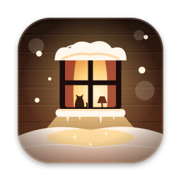

<p align="center"></p>

<h1 align="center">Snowpuff</h1>
<p align="center">Тёплый снег на рабочем столе macOS и Windows.<br>Падает, оседает на окнах, растит сосульки и разлетается от курсора.</p>

<p align="center">
  <a href="https://github.com/ehroz1/Snowpuff/releases/latest"><b>Скачать</b></a> ·
  <a href="https://snowpuff.ehroz.pro">Сайт</a> ·
  <a href="https://ehroz.pro">Другие приложения — ehroz.pro</a> ·
  <a href="https://t.me/hhrrzz1">Поддержать автора ♥</a>
</p>

<p align="center"></p>

## Как это работает

1. Снег идёт поверх всех окон и не мешает работать: клики проходят сквозь него.
2. Он оседает на верхних краях окон, на Dock и панели задач и копится внизу экрана, повторяя скруглённые углы.
3. Проведите курсором по сугробу — снег расступится. Дёрните окно за заголовок — снег соскользнёт, а сосульки под ним
   оборвутся и разобьются. Закройте или сверните окно — снег упадёт в сугроб ниже.

| Режим | Что падает |
|---|---|
| **Снег** | пять видов снегопада, от лёгкого до метели, и «переменный», который сам усиливается и стихает |
| **Осенние листья** | кружатся, ложатся кучами на окна и вдоль низа экрана, слетают с окна, если его дёрнуть |
| **Дождь** | косые струи бьются о верх окон, по стеклу стекают капли и срываются с нижнего края |

## Что умеет

- **Сосульки** растут под окнами со снегом.
- **Тёплый свет окна**: активное окно светится, как окно на иконке, и снег рядом теплеет.
- **Подуть на снег**: включите микрофон и подуйте — снег разлетится. Звук не записывается и никуда не отправляется.
- **Звук**: ветер, камин или оба сразу; синтезируется на лету, громкость настраивается.
- **Не мешает**: на созвонах (когда другое приложение включает камеру или микрофон) снег и звук плавно исчезают,
  над фильмом или игрой во весь экран — тоже. На скриншотах его нет, если не попросить.
- **Бережёт батарею**: на батарее и в режиме энергосбережения рисует реже и скромнее; пока экран спит или заблокирован, стоит.
- Язык интерфейса — русский или английский, по языку системы.

## Установка

**macOS 14+** (Apple Silicon и Intel): скачайте `Snowpuff.dmg`, откройте и запустите Snowpuff — он сам переедет в
«Программы». Приложение не подписано сертификатом Apple, поэтому при первом запуске откройте
«Системные настройки → Конфиденциальность и безопасность» и нажмите «Всё равно открыть». Это нужно один раз.

**Windows 10/11**: скачайте и запустите `Snowpuff-Setup.exe`. Права администратора не нужны. Если SmartScreen
предупредит о неизвестном издателе, нажмите «Подробнее → Выполнить в любом случае».

Установщик Windows и первый запуск на Mac показывают короткое знакомство: что умеет снег, затем страница настроек —
снегопад, звук, сосульки, созвоны, запуск при входе и автообновление.

<p align="center"></p>

## Настройки

Всё основное — в меню значка (в строке меню на Mac, в трее на Windows). Остальное — в **Настройках** (<kbd>⌘,</kbd>
на Mac): режим за окнами, поверх полноэкранных приложений, скриншоты, производительность, запуск при входе, обновления.

Настройки хранятся в отдельном файле, который **остаётся после удаления приложения**. Установите Snowpuff снова —
и он сам подхватит всё, что было выбрано, включая запуск при входе. Файл можно перенести на другой компьютер.

| Система | Файл настроек |
|---|---|
| macOS | `~/Library/Application Support/Snowpuff/settings.json` («Настройки → Система → Показать в Finder») |
| Windows | `%APPDATA%\Snowpuff\settings.json` |

## Обновления

Snowpuff обновляется сам: при запуске, раз в три часа и после пробуждения компьютера он проверяет
[последний релиз](https://github.com/ehroz1/Snowpuff/releases/latest), скачивает новую версию, сверяет её
контрольную сумму SHA-256 и перезапускается. Во время созвона обновление ждёт. Выключить —
«Настройки → Система → Обновлять автоматически» на Mac или пункт «Обновлять автоматически» в меню трея на Windows.

## Надёжность

- Не закрывается молча. Если при входе в систему экраны или видеокарта ещё не готовы, Snowpuff ждёт их, а не выходит.
  Если видеодрайвер перезапустился или кадр не удался, снег запускается заново через секунду.
- После настоящего сбоя приложение открывается снова само (на Mac — через маленький сторож, на Windows — через
  перезапуск Windows). Выход из меню, обновление и «Завершить принудительно» его не перезапускают; три сбоя за десять
  минут — и перезапуск на этот раз останавливается, чтобы не зациклиться.
- Журнал: на Mac — приложение «Консоль» (процесс Snowpuff), на Windows — `%LOCALAPPDATA%\Snowpuff\snowpuff.log`,
  а рядом журнал прошлого запуска, `snowpuff.previous.log`.

## Сборка

macOS (нужны только Command Line Tools):

```sh
./build.sh           # build/Snowpuff.app, универсальный (arm64 + x86_64)
./build.sh install   # + установить в /Applications и запустить
```

Windows (собирается на Mac или Linux; нужны `rustup target add x86_64-pc-windows-gnu` и mingw-w64):

```sh
windows/build.sh     # dist/Snowpuff-Setup.exe
```

Каждый пуш собирается в GitHub Actions на macOS и для Windows (`.github/workflows/build.yml`), готовые сборки лежат
в артефактах запуска.

## Релиз

Без терминала: GitHub → **Actions → Release → Run workflow**, впишите версию (например, `1.3.0`) и что изменилось.
Из терминала:

```sh
./release.sh 1.3.0 "Что изменилось"
```

Скрипт проставляет версию в обоих приложениях, коммитит и пушит тег. В обоих случаях GitHub Actions
(`.github/workflows/release.yml`) сам собирает `Snowpuff.dmg`, `Snowpuff.zip` (его скачивает автообновление на Mac) и
`Snowpuff-Setup.exe` и публикует релиз. Обе версии подхватят его сами.

## Устройство

| Путь | Что внутри |
|---|---|
| `Sources/Snowpuff/` | приложение для macOS (Swift, Metal, SwiftUI для окон знакомства и настроек) |
| `windows/` | приложение и установщик для Windows (Rust, Direct3D 11, Direct2D) |
| `core/` | общая для Windows физика снега, сосульки, синтез звука, проверка обновлений (тесты: `cd core && cargo test`) |
| `Assets/` | иконки и палитра |

## Лицензия и благодарности

Основан на [Snowhush](https://github.com/mbezruchko/Snowhush) © Mykhailo Bezruchko: код версий до 0.6.1 включительно,
вышедших под MIT, в том числе режим «Осенние листья». С 0.6.2 Snowhush перешёл на некоммерческую лицензию PolyForm,
поэтому дождь, скрытие над полноэкранными приложениями и меню «Производительность» написаны для Snowpuff заново,
без кода Snowhush.

Сделано [ehroz.pro](https://ehroz.pro).
