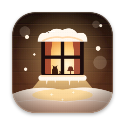

<h1 align="center">Snowpuff</h1>

Тёплый снег на рабочем столе macOS, Windows и Linux. Падает, оседает на окнах и в обоях, растит сосульки и разлетается от курсора.

  <a href="https://github.com/ehroz1/Snowpuff/releases/latest"><b>Скачать</b></a> ·
  <a href="https://snowpuff.ehroz.pro">Сайт</a> ·
  <a href="https://ehroz.pro">Другие приложения — ehroz.pro</a> ·
  <a href="https://t.me/hhrrzz1">Поддержать автора ♥</a>

## Как это работает

1. Снег идёт поверх всех окон и не мешает работать: клики проходят сквозь него.
2. Он оседает на верхних краях окон, на Dock и панели задач, на виджетах, на рамке выделения и внизу экрана, повторяя
   скруглённые углы. С включёнными «Обоями» снег ложится и на то, что нарисовано на обоях: на крыши, ветки, склоны.
3. Проведите курсором по сугробу — снег расступится. Дёрните окно — снег соскользнёт, а сосульки под ним оборвутся.
   Закройте или сверните окно — снег упадёт в сугроб ниже. Перетащите окно на другой монитор — снег поедет с ним.

| Режим | Что падает |
|---|---|
| **Снег** | от лёгкого до метели; на Новый год — ёлка и салют, на Хеллоуин — тыквы и привидения |
| **Осенние листья** | дуб, клён и осина, нарисованные по фотографиям; ложатся кучами и вянут |
| **Дождь** | бьётся о верх окон, стекает каплями по стеклу, висит на нижнем краю |
| **Цветение сакуры** | лепестки и иногда целые цветки; светятся на просвет и буреют по краям |
| **Град** | градины отскакивают от окон и низа экрана |
| **Смешанный** | два вида сразу: снег с листьями, дождь с лепестками и так далее |

«Погода за окном» включает снег, дождь или град, как сейчас у вас на улице (Open-Meteo, место округляется до ~10 км).

## Что умеет

- **Снег в обоях**: небольшая нейросеть один раз читает глубину картинки на рабочем столе, дальние снежинки падают за
  ближние предметы, а снег копится на том, что в обоях выше и ровнее.
- **Снежки с друзьями**: «Снежки» в меню — позовите друга ссылкой или зайдите по его ссылке и бросайте снежки
  в снеговиков на обоях. Соединение идёт напрямую между игроками (iroh), без своего сервера.
- **Сосульки** растут под окнами со снегом. Клик по сосульке сбивает её со звоном.
- **Тёплый свет окна**: активное окно светится, и снег рядом теплеет.
- **Морозные узоры** растут с краёв экрана, в дождь стекло запотевает. Зажмите ⌥ (Alt на Windows) и рисуйте по ним.
- **Живность и ночь**: из сугроба выглядывает кот, на окна садится снегирь; ночью звёзды и метеоры, туман по низу,
  гирлянда на окнах, вихрь за быстрым курсором.
- **Звук**: ветер, камин или оба сразу, шум дождя и града, хруст снега, звон сосулек — всё синтезируется на лету.
- **Подуть на снег**: включите микрофон и подуйте — снег разлетится. Звук не записывается и никуда не отправляется.
- **Не мешает**: на созвонах снег и звук плавно исчезают, над фильмом или игрой во весь экран — тоже. На скриншотах
  его нет, если не попросить. На батарее рисует реже, пока экран спит — стоит.
- **Слово «снег»**: наберите «снег» или «snow» где угодно — пойдёт густой снегопад (включается в настройках).
- Меню на девяти языках, по языку системы.

## Как пользоваться

| Что сделать | Как |
|---|---|
| Рисовать по инею или запотевшему стеклу | Зажмите ⌥/Alt и ведите курсором у края экрана |
| Сбить сосульку | Кликните по ней |
| Метель за курсором | Быстро махните мышью |
| Бросить снежок в игре | ⌘-клик по обоям на Mac, Ctrl-клик на Windows и Linux |

**Горячие клавиши** работают в любой программе — ⌃⌥+буква на Mac, Ctrl+Alt+буква на Windows:

| Клавиша | Что делает |
|---|---|
| S | снег вкл / выкл |
| M | следующий режим |
| C | смести весь снег |
| F | морозные узоры вкл / выкл |
| G | гирлянда на окнах вкл / выкл |
| H | подсказка «Как пользоваться» |

## Установка

**macOS 14+** (Apple Silicon и Intel): скачайте `Snowpuff.dmg`, откройте и запустите Snowpuff — он сам переедет в
«Программы». Приложение не подписано сертификатом Apple, поэтому при первом запуске откройте
«Системные настройки → Конфиденциальность и безопасность» и нажмите «Всё равно открыть». Это нужно один раз.

**Windows 10/11**: скачайте и запустите `Snowpuff-Setup.exe`. Права администратора не нужны. Если SmartScreen
предупредит о неизвестном издателе, нажмите «Подробнее → Выполнить в любом случае».

**Linux** (KDE Plasma 6, Hyprland, Sway и niri на Wayland): `Snowpuff-x86_64.AppImage`, `.deb` или `.rpm` из
последнего релиза.

## Настройки и обновления

Всё — в меню значка (в строке меню на Mac, в трее на Windows): интенсивность и непрозрачность, «Накопление»
(где оседает снег), режимы, «Снежки», а в «Настройках» — поведение, отображение, «Волшебство» и «Звук».

Настройки хранятся ещё и в отдельном файле, который **остаётся после удаления приложения**: установите Snowpuff снова —
и он подхватит всё, что было выбрано.

| Система | Файл настроек |
|---|---|
| macOS | `~/Library/Application Support/Snowpuff/settings.json` («Настройки → Показать файл настроек») |
| Windows | `%APPDATA%\Snowpuff\settings.json` |

Mac и Windows сами проверяют [последний релиз](https://github.com/ehroz1/Snowpuff/releases/latest), скачивают новую
версию, сверяют её SHA-256 с тем, что сообщает GitHub, и ставят её. Выключается в «Настройки → Обновляться автоматически».

## Сборка

- Mac: `./build.sh` (нужны Rust и Swift; `./build.sh install` — поставить и запустить).
- Windows: `cargo build --release --bin Snowpuff --manifest-path windows/Cargo.toml` на Windows.
- Linux: `cargo build --release --manifest-path linux/Cargo.toml` (нужен `libwayland-dev`).
- Выпуск: `./release.sh 1.4.0 "Что изменилось"` — GitHub Actions соберёт и опубликует релиз.

## Лицензия и благодарности

Snowpuff основан на [Snowhush](https://github.com/mbezruchko/Snowhush) © 2026 Mykhailo Bezruchko. С версии 1.4 в него
вошло всё из Snowhush 0.14, а там, где одна и та же возможность была в обоих, оставлен вариант Snowhush. Поэтому
Snowpuff, как и Snowhush, распространяется под некоммерческой лицензией
[PolyForm Noncommercial 1.0.0](LICENSE): им можно пользоваться, делиться и менять его, но не продавать и не строить на
нём платные приложения. Версии Snowpuff до 1.3.2 включительно остаются под MIT.

Своё у Snowpuff: сосульки, тёплый свет окна, морозные узоры, гирлянда, звёзды, туман, кот и снегирь, град,
«Погода за окном», звуки, «Подуть на снег», «Прятать на созвонах», горячие клавиши, файл настроек и обновления
с GitHub.

Нейросеть глубины — Depth Anything V2 Small (Apache-2.0); остальные сторонние лицензии — в `Resources/ThirdParty`.

Сделано [ehroz.pro](https://ehroz.pro).
